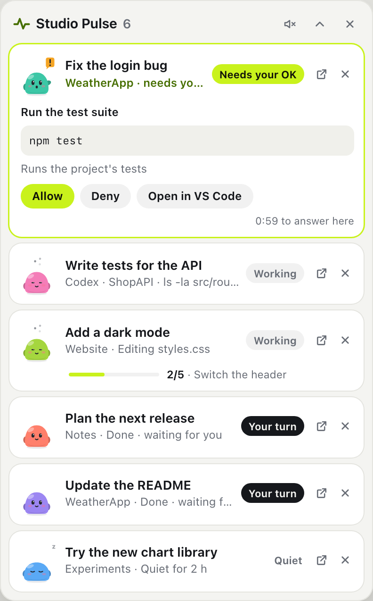
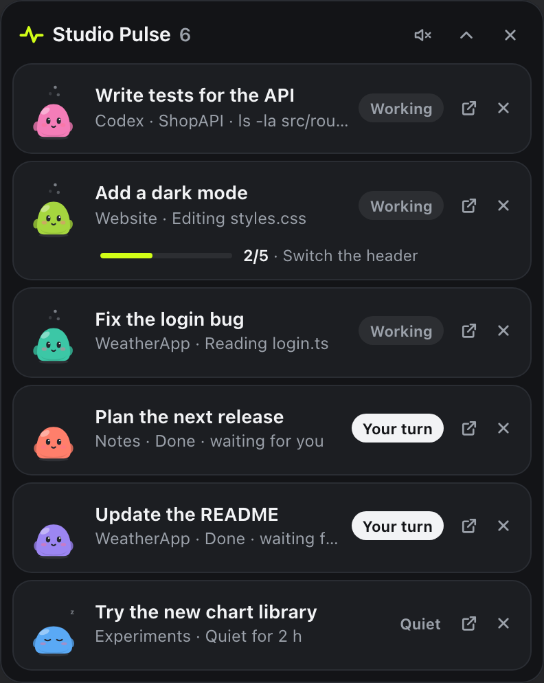
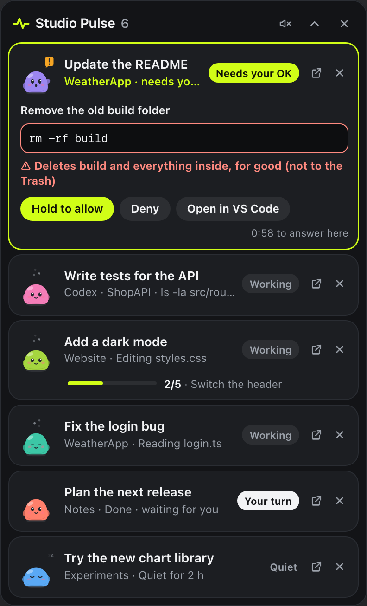
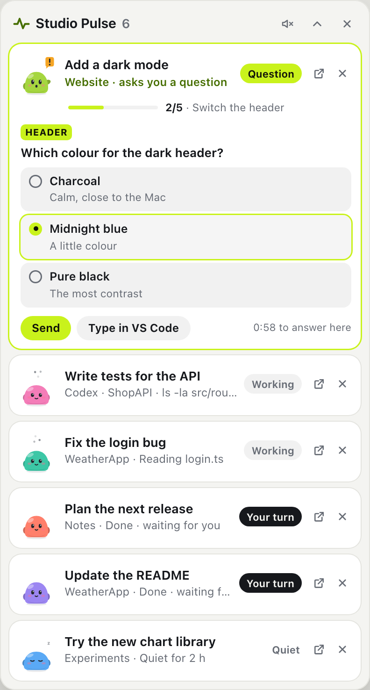
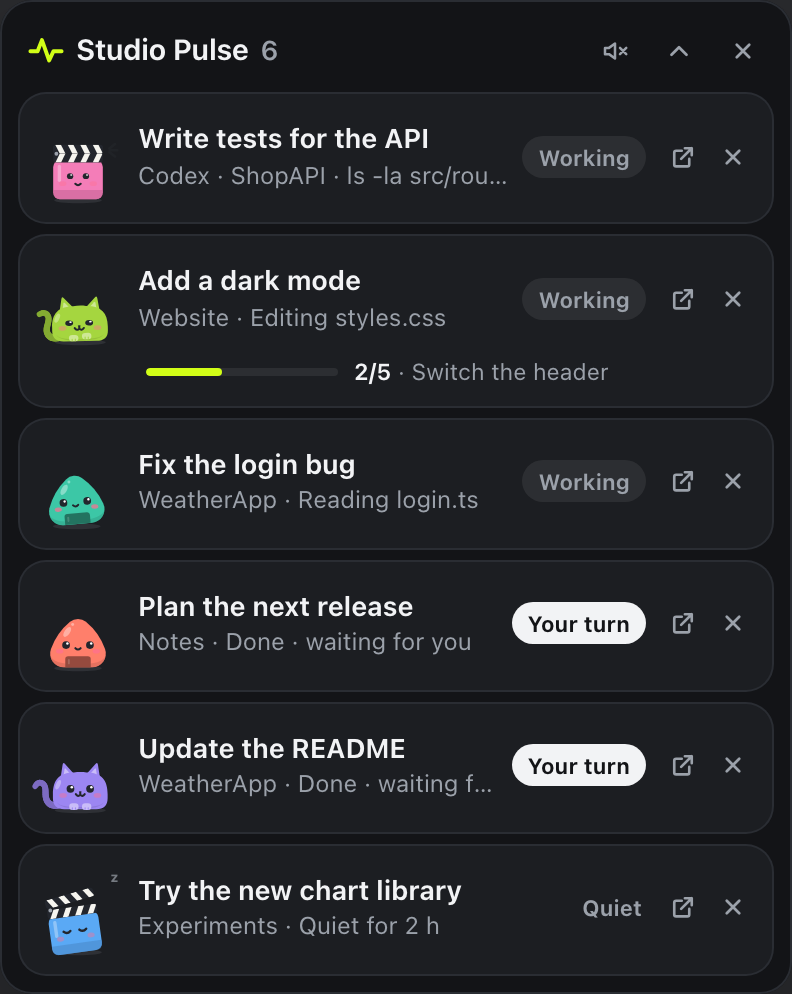

# Studio Pulse

**Every Claude Code and Codex chat on your Mac, in one small floating panel.**
See which chats are working, which one needs your OK, and answer it with one click, without hunting for the right window.

Free. Made by Anthony Dacles.

<p align="center">
  
  &nbsp;
  
</p>

## What it does
- **All your chats in one place.** Claude Code in Visual Studio Code, in the Terminal and in the Claude desktop app, plus Codex chats.
  Each chat gets a row and its own little character.
- **See the state at a glance:** working, needs your OK, your turn, or quiet. Plus progress from the chat's to-do list.
- **Allow or Deny from the panel.** When a chat asks permission, the request pops up in the panel. One click answers it.
- **Plain words under every command.** `rm -rf build` comes with "Deletes build and everything inside, for good".
- **Risky requests are red** and need a one-second hold, so a quick click can't approve something that deletes your work.
- **Answer Claude Code's multiple-choice questions** right in the panel.
- **Keyboard shortcuts from any app:** ⌃⌥⌘A allow the oldest request · ⌃⌥⌘D deny it · ⌃⌥⌘P show or hide the panel.
- **"Needs a look" warnings** when a chat repeats the same command or seems stuck.
- **↗ jumps to the chat** (its VS Code window, the Claude app, the Codex app).
- **Seven characters** (Mochi, Nigi, Boo, Miso, Puff, Pip, Slate, or a mix) and three looks: Dark, White and Liquid Glass.

<p align="center">
  
  &nbsp;
  
  &nbsp;
  
</p>

## Who it's for
People who use **Claude Code** or **Codex** on a Mac and often have a few chats going at once.

**You need:** a Mac with **Apple silicon** (M1 or newer) and **macOS 13 Ventura or newer**.
Tested on macOS 27. Liquid Glass needs macOS 26 or newer. Intel Macs are not supported.

## Install
Open **Terminal** (press ⌘ Space, type *Terminal*, press Return), paste this line and press Return:

```bash
curl -fsSL https://github.com/amdacles/studio-pulse/releases/latest/download/install.sh | bash
```

The install script:
1. checks your Mac (Apple silicon, macOS 13 or newer);
2. downloads Studio Pulse from this page's latest release;
3. checks the download's fingerprint (SHA-256). If it doesn't match, nothing is installed;
4. puts **Studio Pulse** in your Applications folder and opens it.

It needs no password. You can [read the script](install.sh)
before you run it: it's short.

**To update later,** quit Studio Pulse and run the same line again.

### Why a Terminal command?
Studio Pulse is free, and I don't pay for Apple's yearly developer signature. Without it, macOS shows
"Apple could not verify…" for any app you download in a browser. A download made in Terminal doesn't get that check.
Claude Code installs the same way.

### Prefer to download it yourself?
1. Download **Studio-Pulse-2.3.zip** from the [latest release](https://github.com/amdacles/studio-pulse/releases/latest)
   and double-click it.
2. Drag **Studio Pulse** into your **Applications** folder and open it. macOS says *"Studio Pulse" Not Opened*: click **Done**.
3. Open **System Settings › Privacy & Security**, scroll down to *"Studio Pulse" was blocked…* and click **Open Anyway**.
   Enter your Mac password. (The button stays for about an hour after you tried to open the app.)
4. Open Studio Pulse again and click **Open**.

## First steps
1. Look for the **pulse icon** in your menu bar. The panel opens.
2. Click **Connect to Claude Code** once. Studio Pulse adds its small hooks to Claude Code's settings
   (`~/.claude/settings.json`) and keeps a backup. Nothing else in that file changes.
3. **Codex too?** Studio Pulse's **Settings › Connections › Codex › Connect**. Then, once, inside Codex: type `/hooks`
   (in the Codex app: **Settings › Hooks**) and trust Studio Pulse's hooks. Codex only runs hooks you have approved.
4. Start a chat. It shows up in the panel.

**Good to know:** Claude Code shows its own prompt at the same time as the panel. Whichever you answer first wins.
Codex waits up to 30 seconds for the panel, then asks in its own window.

## Privacy
**Everything stays on your Mac. Nothing is sent online.** No account, no analytics, no tracking, no ads.
- Studio Pulse keeps short notes about each chat (name, folder, current step, the command it wants to run, its to-do list)
  in `~/Library/Application Support/Studio Pulse`. Chat notes are deleted after 3 days. A log of the answers you click stays until
  you uninstall.
- The panel talks only to a tiny server on your own Mac (127.0.0.1), locked with a key that only your Mac user can read.
- It never reads, stores or sends your Claude or OpenAI sign-in.
- It never allows anything by itself. It only passes on your click.

Details: [PRIVACY.md](PRIVACY.md).

## Known limits
- Codex's multiple-choice questions can't be answered from the panel (Codex doesn't allow it yet). Its permissions can.
- One-off runs (`claude -p`, `codex exec`) can't ask for permission, so there is nothing to answer.
- Codex inside the VS Code extension: not tested yet.
- ↗ uses links the Claude and Codex apps understand today. If an update changes them, ↗ just brings the app forward.
- Claude Code and Codex updates can change how hooks work. If chats stop showing up, open Settings › Connections and connect again,
  and [tell me](https://github.com/amdacles/studio-pulse/issues).
- Mac banners appear under "Script Editor" in System Settings › Notifications.

## Uninstall
**Studio Pulse › Settings › About › Uninstall Studio Pulse…** It removes the app, its hooks in Claude Code and Codex, its login
item and all its files. Your chats are not touched.

<details>
<summary>The app won't open? Uninstall by hand</summary>

Quit Studio Pulse if it's running, then paste these lines in Terminal, one at a time:

```bash
"$HOME/Library/Application Support/Studio Pulse/runtime/pulse" setup disconnect
"$HOME/Library/Application Support/Studio Pulse/runtime/pulse" setup codex-disconnect
"$HOME/Library/Application Support/Studio Pulse/runtime/pulse" setup remove-files
```

Then drag **Studio Pulse** from Applications to the Trash. If it's still listed in **System Settings › General › Login Items**,
remove it there.
</details>

## Report a problem
[Open an issue](https://github.com/amdacles/studio-pulse/issues/new/choose) and tell me your macOS version, your Studio Pulse
version (Settings › About) and what happened. Please blur chat names, folders or commands you don't want to share.

## Licence
Studio Pulse is **free to use**, but it isn't open source. See [LICENSE](LICENSE). Please share the link to this page rather
than the app file. What changed in each version: [CHANGELOG.md](CHANGELOG.md).

Studio Pulse is not affiliated with, endorsed by or sponsored by Anthropic, OpenAI or Microsoft. Claude and Claude Code are
trademarks of Anthropic PBC, Codex is a trademark of OpenAI, and Visual Studio Code is a trademark of Microsoft Corporation.
They are named only to say what Studio Pulse works with.

Third-party parts: [GSAP](https://gsap.com) by GreenSock (standard no-charge licence) and the sound
["Notification Sound 1"](https://freesound.org/people/deadrobotmusic/sounds/750607/) by deadrobotmusic (CC0).
